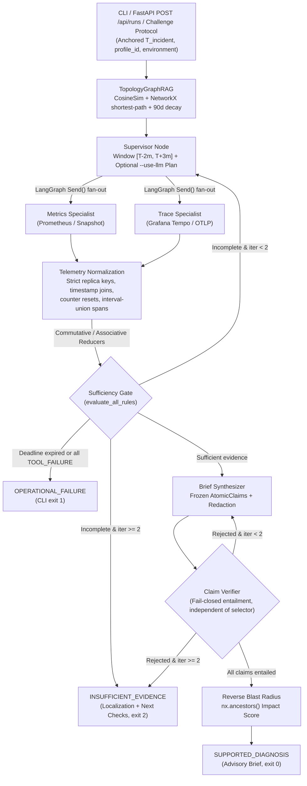

# Sentinel-Ops Architecture

Sentinel-Ops pairs LangGraph workflow orchestration (and optional `--use-llm` Gemini query planning) with deterministic telemetry normalization, CRAG sufficiency checks, isolated claim verification, and YAML `SystemProfile` configuration.

---

## 1. Execution Flow

---

## 2. Module Responsibilities

| Layer | Responsibility | Key Modules |
|---|---|---|
| **Control Plane & Persistence** | Run intake, monotonic deadlines (`30s` default), SSE streams (`Last-Event-ID`), idempotency `409` checks, `SQLite WAL`, env scoping (`403`) | `service/runner.py`, `storage/repository.py`, `server/app.py`, `cli.py` |
| **Graph & Reducers** | Compiled `StateGraph`, bounded `Send()` fan-out, commutative/associative `Annotated` reducers, `MemorySaver` checkpoints | `agents/graph.py`, `agents/state.py`, `agents/supervisor.py`, `agents/sufficiency.py` |
| **LLM Planning & Brief Prose** | Structured output planning/summaries, `GeminiKeyRing` rotation + cooldowns (`429`/auth), per-key `4.2s` `AsyncRateLimiter` | `core/config.py`, `core/llm.py`, `core/prober.py`, `agents/llm_planner.py` |
| **Telemetry Normalization** | Parity across `LiveTelemetryReader` & `SnapshotReplayReader`, `SHA-256[:24]` observation IDs, revision conflict detection, series truncation (`PARTIAL`), OTLP interval union | `telemetry/reader.py`, `telemetry/normalize.py`, `telemetry/models.py` |
| **Rules & Verification** | Pilot timeout-family rules (`pool_acquisition_timeout`, `upstream_connect_timeout`), 3 claim scopes, independent entailment checks | `rules/engine.py`, `agents/adversarial.py`, `agents/synthesizer.py` |
| **Graph Intelligence & Profiles** | `TopologyGraphRAG`, reverse `nx.ancestors()` blast radius, YAML `SystemProfile` DAG/PromQL/threshold checks + `--preflight` | `memory/graph_rag.py`, `agents/blast_radius.py`, `profiles/schema.py`, `profiles/registry.py` |
| **Adapters, MCP & Security** | Pooled async `HTTPX` adapters, dual-transport MCP (`stdio` `raw_decode` + `POST /mcp`), `<telemetry>` sanitization & credential scrubbing | `mcp/server.py`, `mcp/prometheus_adapter.py`, `mcp/tempo_adapter.py`, `security/` |

---

## 3. Verification Invariants

1. **Pilot Certification Boundary (`EXPERIMENTAL_RULES_ENABLED = False`):**
   Automated causal certification is enabled by default only for verified timeout-family mechanisms (`pool_acquisition_timeout` / `db_pool_exhaustion`, `upstream_connect_timeout`). Experimental rules (`cpu_contention`, `memory_pressure_restarts`) require explicit opt-in along with normalized `[0.0, 1.0]` ratios, duration-unit normalization, and same-replica alignment.
2. **Replica Isolation & Exact-Timestamp Joins:**
   Replica identity uses only `("pod", "instance", "container")` (`service`/`app` tags are ignored during replica matching). Capacity checks match both `join_key` and identical evaluation timestamps (`common_ts[-1]`) to avoid cross-pod masking or staggered-sample ratio errors.
3. **Counter & Ratio Checks:**
   Raw cumulative counters mapped onto utilization/ratio signals (such as un-rated `container_cpu_usage_seconds_total`) are marked `INVALID_MEASUREMENT` during normalization.
4. **Trace Interval-Union Self-Time (`_compute_merged_duration_ms`):**
   Parent span exclusive duration merges overlapping child nanosecond intervals before subtraction so concurrent async fan-out calls do not yield negative self-time.
5. **Independent Claim Verifier:**
   `adversarial_reviewer_node` validates claims against normalized observations without reusing rule-selection state: disabled mechanisms fail closed, `PARTIAL`/truncated series block falsification claims, and contradicting revisions or counter resets prevent certification.
6. **Claim Scopes:**
   - `affected_request`: Alerted `trace_id` has a matching timed-out child span (`TimeoutError` or `DEADLINE_EXCEEDED`) and a positive dependency timeout counter delta.
   - `replica_correlated`: Capacity saturation ($\ge 0.95$) and timeout delta occur on the same `replica_key`.
   - `service_fleet`: Service-level signals corroborate across fleet telemetry (`case_01`) without claiming per-pod or per-request causality.

---

## 4. Quantitative Models

- **Topology-Aware GraphRAG (`memory/graph_rag.py`):**
  $$\text{Score}(A, P) = 0.5 \cdot \text{CosineSim}(T_{\text{alert}}, T_P) + 0.3 \cdot \frac{1}{1 + d_{\text{shortest}}(S_{\text{alert}}, S_P)} + 0.2 \cdot e^{-\Delta t_{\text{days}} / 90.0}$$
- **Reverse Blast Radius (`agents/blast_radius.py`):**
  Traverses `nx.ancestors(graph, target_service)` with bounded action weights (`config_reload: 0.1`, `restart: 0.5`, `db_pool_resize: 0.8`):
  $$\text{Score} = \min\!\Big(1.0,\; 0.6 \cdot \frac{|\text{ancestors}|}{\max(1, |V|-1)} + 0.4 \cdot w_{\text{action}} + \text{ingress\_exposure}\Big)$$

---

## 5. Automated Checks

- **`pytest` (`sentinel-ops/tests/`):** 242 tests covering reducer commutativity, SSE/SQLite restart recovery, MCP `stdio` framing, brief redaction, and profile validation.
- **Counterfactual Gate (`benchmarks.challenge_gate`):** 84 blind cases per seed across 17 perturbation families checking causal grounding and safe abstention.
- **Replay Suite (`benchmarks.runner`):** 5 offline scenarios (`case_01`–`case_05`) compared against deterministic and heuristic baselines.
- **Sandbox Verification (`scripts/verify_sandbox_faults.py`):** Live checks across a 6-container Docker Compose stack (`checkout`, `cart`, `pricing`, `payment`, Prometheus, Tempo) with positive and negative controls.
