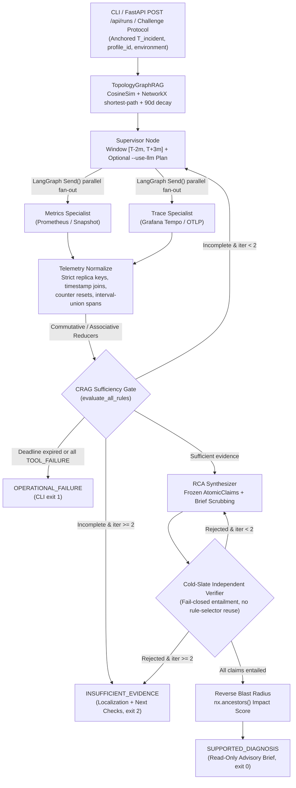

# Sentinel-Ops Technical Architecture

**Sentinel-Ops** is a neuro-symbolic autonomous Site Reliability Engineering (SRE) platform built to separate plausible guesswork from evidence-backed root cause analysis. It pairs bounded **LangGraph** workflow orchestration and optional **Gemini** probe planning (`--use-llm`) with strict deterministic telemetry normalization, **CRAG** sufficiency gating, a fail-closed **Cold-Slate Verifier**, and declarative **`SystemProfile`** portability.

---

## 1. End-to-End Execution Architecture

---

## 2. Core Architectural Layers

| Layer | Responsibility | Key Modules |
|---|---|---|
| **Control Plane & Lifecycle** | Run intake, monotonic deadline tracking (`30s` default), SSE event streaming (`Last-Event-ID`), idempotency `409` checks, `SQLite WAL` persistence, env-scope `403` enforcement | `service/runner.py`, `storage/repository.py`, `server/app.py`, `cli.py` |
| **Agent Graph & Reducers** | Compiled `StateGraph`, `Send()` fan-out, commutative/associative/idempotent `Annotated` reducers, `MemorySaver` checkpointer | `agents/graph.py`, `agents/state.py`, `agents/supervisor.py`, `agents/sufficiency.py` |
| **Neuro-Symbolic LLM Layer** | Bounded `with_structured_output()` planning & brief narrative generation, multi-key `GeminiKeyRing` round-robin rotation + `429`/auth cooldown failover, per-key `4.2s` `AsyncRateLimiter` | `core/config.py`, `core/llm.py`, `core/prober.py`, `agents/llm_planner.py` |
| **Telemetry Ingestion & Normalization** | Shared `LiveTelemetryReader` / `SnapshotReplayReader` parity, `SHA-256[:24]` content-addressed observation IDs, revision conflict detection, series truncation tracking (`PARTIAL`), OTLP interval-union self-time | `telemetry/reader.py`, `telemetry/normalize.py`, `telemetry/models.py` |
| **Causal Rules & Cold-Slate Verifier** | Pilot-scoped rules (`pool_acquisition_timeout`, `upstream_connect_timeout`), 3 claim scopes (`affected_request`, `replica_correlated`, `service_fleet`), independent verification without selector reuse | `rules/engine.py`, `agents/adversarial.py`, `agents/synthesizer.py` |
| **Graph Intelligence & Portability** | `TopologyGraphRAG`, reverse `nx.ancestors()` blast radius, YAML `SystemProfile` DAG/PromQL/threshold validation + 2-stage `--preflight` | `memory/graph_rag.py`, `agents/blast_radius.py`, `profiles/schema.py`, `profiles/registry.py` |
| **Adapters, MCP & Security** | Pooled async `HTTPX` adapters, dual-transport MCP (`stdio` incremental `raw_decode` + `POST /mcp` JSON-RPC 2.0), `<telemetry>` prompt-injection firewall & credential/PII scrubber | `mcp/server.py`, `mcp/prometheus_adapter.py`, `mcp/tempo_adapter.py`, `security/` |

---

## 3. Epistemic Truthfulness & Safety Invariants

1. **Pilot Certification Boundary (`EXPERIMENTAL_RULES_ENABLED = False`):**
   Causal certification is restricted by default to verified timeout-family mechanisms (`pool_acquisition_timeout` / `db_pool_exhaustion`, `upstream_connect_timeout`). Experimental rules (`cpu_contention`, `memory_pressure_restarts`) require explicit opt-in plus strict `[0.0, 1.0]` ratio, duration-unit normalization, and same-replica preconditions.
2. **Strict Replica Isolation & Exact-Timestamp Joins:**
   Replica identity is extracted solely from `("pod", "instance", "container")`. Capacity occupancy checks require matching `join_key` **and** identical evaluation timestamp `common_ts[-1]`, preventing cross-pod collapse or staggered-sample division errors.
3. **Counter & Ratio Semantic Guards:**
   Cumulative counters mapped onto ratio/utilization gauges (e.g., raw `container_cpu_usage_seconds_total` without `rate()`) are rejected at normalization as `INVALID_MEASUREMENT`, never falsely triggering threshold alerts.
4. **Trace Interval-Union Self-Time (`_compute_merged_duration_ms`):**
   Exclusive parent duration merges overlapping child nanosecond intervals before subtracting from parent duration, preventing impossible negative self-time under concurrent fan-out RPCs.
5. **Cold-Slate Adversarial Verification:**
   `adversarial_reviewer_node` audits claims independently from immutable observations: unknown/disabled mechanisms fail closed, truncated (`PARTIAL`) series cannot substantiate fleet-wide falsification claims, and contradicting revisions or fleet counter resets block certification.
6. **Three Distinct Claim Scopes:**
   - `affected_request`: Alerted `trace_id` exhibits matching operation error (`TimeoutError` or `DEADLINE_EXCEEDED`) + positive dependency timeout counter delta.
   - `replica_correlated`: Capacity saturation ($\ge 0.95$) and timeout delta align on the identical `replica_key`.
   - `service_fleet`: Service-level signals corroborate without per-pod isolation (`case_01`), never misattributed to a single request trace.

---

## 4. Quantitative Models

- **Topology-Aware GraphRAG Score (`memory/graph_rag.py`):**
  $$\text{Score}(A, P) = 0.5 \cdot \text{CosineSim}(T_{\text{alert}}, T_P) + 0.3 \cdot \frac{1}{1 + d_{\text{shortest}}(S_{\text{alert}}, S_P)} + 0.2 \cdot e^{-\Delta t_{\text{days}} / 90.0}$$
- **Reverse Blast Radius (`agents/blast_radius.py`):**
  Traverses `nx.ancestors(graph, target_service)` (upstream callers impacted by modifying the failing dependency) with bounded action risk weights (`config_reload: 0.1`, `restart: 0.5`, `db_pool_resize: 0.8`):
  $$\text{Score} = \min\!\Big(1.0,\; 0.6 \cdot \frac{|\text{ancestors}|}{\max(1, |V|-1)} + 0.4 \cdot w_{\text{action}} + \text{ingress\_exposure}\Big)$$

---

## 5. Verification Gates

| Suite | Scope | Verified Result |
|---|---|---|
| `pytest` (`sentinel-ops/tests/`) | Unit invariants, concurrency reducers, SSE/SQLite restart lifecycle, MCP stdio framing, brief security, profile DAG validation | **242 passed** |
| Counterfactual Gate (`benchmarks.challenge_gate`) | 84 blind cases per seed across 17 perturbation families (`TimeoutError`/`DEADLINE_EXCEEDED`, randomized span IDs, truncated 6-pod series, cross-pod collapse, conflicting retries) | **84 / 84 (100%)**, 0 false support |
| Replay Benchmark (`benchmarks.runner`) | 5 offline incident cases (`case_01`–`case_05`) vs deterministic & heuristic baselines | **100% precision (1/1)**, **100% safe abstention (4/4)** |
| Live Chaos Sandbox (`scripts/verify_sandbox_faults.py`) | 6-container Docker Compose stack (`checkout`, `cart`, `pricing`, `payment`, Prometheus, Tempo) with positive & negative fault controls | **All positive & negative controls passing** |
