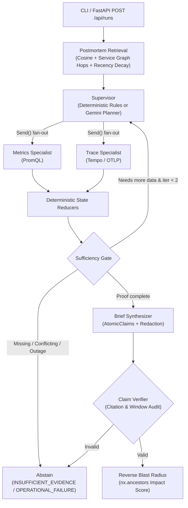

# Sentinel-Ops

Automated incident triage over Prometheus metrics and OpenTelemetry traces, with deterministic verification so missing or noisy telemetry produces an abstention instead of a guessed root cause.

[](https://github.com/vedant-asati/sentinel-ops/actions/workflows/ci.yml)
[](https://www.python.org/downloads/)
[](LICENSE)

LLM triage agents tend to hallucinate a plausible failing service even when metrics are truncated, cumulative counters aren't rated, or pods disagree. Sentinel-Ops separates query planning (deterministic by default, optional Gemini planning via `--use-llm`) from verification: parallel worker nodes normalize signals strictly by `pod`/`instance`/`container`, evaluate shared rules across time-aligned series and span intervals, and check every cited `AtomicClaim` in an isolated verifier before emitting a diagnosis.

---

## Quickstart

Requires Python `3.12+` and [`uv`](https://docs.astral.sh/uv/). Docker Compose is only needed if you want to run the live multi-service chaos sandbox.

```bash
cd sentinel-ops
uv sync --extra dev

# Run the unit and integration test suite
uv run --extra dev pytest -q

# Investigate offline replay cases (case_01 proves DB pool exhaustion; case_03 abstains cleanly)
uv run python -m sentinel_ops.cli --case-id case_01
uv run python -m sentinel_ops.cli --case-id case_03
```

Optional modes:

```bash
# Run the web UI and resumable SSE API (http://localhost:8000)
cd sentinel-ops
uv run uvicorn sentinel_ops.server.app:app --port 8000

# Run the live 6-container Docker sandbox demo (Prometheus, Tempo, synthetic services)
./demo.sh
```

See [sentinel-ops/README.md](sentinel-ops/README.md) for CLI flags (`--use-llm`, `--profile`, `--export-brief`, `--export-dpo`) and sandbox chaos injection commands.

---

## Architecture



See [ARCHITECTURE.md](ARCHITECTURE.md) for state reducer semantics, claim scope rules, MCP transports (`stdio` and `POST /mcp`), and SQLite WAL lifecycle details.

---

## How it works

- Queries run inside a LangGraph `StateGraph` using `Send()` fan-out capped by an event-loop semaphore and per-query timeouts (`3s` per backend probe, `30s` total run deadline). Parallel results fold back through commutative reducers keyed by content-revision hashes so retries deduplicate cleanly without hiding conflicting observations.
- Telemetry normalization rejects `NaN`/`Inf` readings, un-rated cumulative counters mapped to ratio signals, and staggered timestamps. Replica correlation strips `service`/`app` fleet tags and joins only on `pod`, `instance`, or `container`. Parent span exclusive time subtracts merged overlapping child span intervals rather than summing raw durations.
- Historical postmortem retrieval (`TopologyGraphRAG`) combines term-frequency cosine similarity (`0.5`), shortest-path distance on a NetworkX service DAG (`0.3`), and 90-day exponential recency decay (`0.2`).
- Downstream impact is estimated over upstream callers via `nx.ancestors` in the active topology graph (`config_reload`, `restart`, `db_pool_resize`). Unknown services or unapproved actions fail closed.
- Service topologies, PromQL templates, and metric thresholds live in YAML profile files (`sentinel-ops/profiles/`) validated for acyclicity before execution.
- Multi-key Gemini rotation handles `429` rate limits (`60s` cooldown) and auth errors (`3600s` cooldown) across `GEMINI_API_KEY`..`GEMINI_API_KEY_N` with per-key rate limiting.

---

## Verification and evaluation

All checks below run offline in CI without API keys unless `--live-llm` is passed explicitly:

- **Unit and integration suite (`pytest`):** 242 tests covering reducer commutativity, concurrent SSE `Last-Event-ID` streaming and SQLite crash recovery, idempotency conflicts (`409`), MCP `stdio` JSON framing, YAML profile validation, prompt-injection sanitization, and secret scrubbing.
- **Counterfactual challenge harness (`benchmarks.challenge_gate`):** Generates 84 blind cases per seed across 17 fault variations (timeout deltas, missing signals, truncated 6-pod responses, cross-pod mismatches, stale windows, raw counters, backend outages). On the reference run (`--seed 42`), all 84 cases match expected behavior with zero unsupported diagnoses. See [sentinel-ops/benchmarks/README.md](sentinel-ops/benchmarks/README.md) for the candidate protocol.
- **Replay fixtures (`benchmarks.runner`):** Across the 5 bundled scenarios (`case_01`–`case_05`), Sentinel-Ops confirms `case_01` (`payment-service` DB pool exhaustion) and safely abstains on the remaining 4 incomplete or out-of-scope cases while localizing slow spans where trace data is available.
- **Docker sandbox check (`scripts/verify_sandbox_faults.py`):** Verifies live Prometheus and Tempo ingestion against injected container faults alongside healthy/non-fault negative controls.

---

## Repository structure

```text
.
├── ARCHITECTURE.md           # Control plane, safety invariants, and internal design
├── SECURITY.md               # Sanitization, redaction, and vulnerability reporting
├── demo.sh                   # End-to-end live Docker chaos walkthrough
├── .env.example              # Optional Gemini API key and endpoint overrides
└── sentinel-ops/
    ├── src/sentinel_ops/     # LangGraph engine, rules, GraphRAG, MCP, FastAPI, SQLite WAL
    ├── profiles/             # YAML topology and signal definitions
    ├── benchmarks/           # Replay runner, baselines, and counterfactual challenge harness
    ├── deploy/               # Docker Compose stack (Prometheus, Tempo, synthetic services)
    ├── scripts/              # Sandbox verification and stress scripts
    └── tests/                # 242 automated tests
```

---

## License

[MIT](LICENSE)
